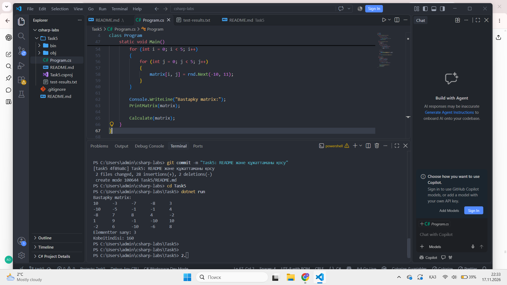

# 5-тапсырма. Екі өлшемді массивтер

## Жұмыстың мақсаты

Екі өлшемді массивтермен жұмыс істеуді үйрену. Матрица элементтерін өңдеу, негізгі диагональдан жоғары орналасқан оң жұп элементтерді табу, олардың санын есептеу және көбейтіндісін анықтау.

## Тапсырманың шарты

5 × 5 өлшемді матрица кездейсоқ сандармен толтырылады. Негізгі диагональдан жоғары орналасқан оң жұп элементтердің саны мен көбейтіндісін табу қажет.

## Бағдарламаның нәтижесі

Матрицаны толтыру және есептеу кезінде GetLength(0) және GetLength(1) әдістері қолданылады.

## Тестілеу

| № | Тест түрі | Кіріс деректері | Күтілетін нәтиже | Бағдарлама нәтижесі |
|---|---|---|---|---|
| 1 | Жеке тест | Random(12), 5×5 матрица | Саны: 3, көбейтіндісі: 160 | Саны: 3, көбейтіндісі: 160 |
| 2 | Өзім құрған тест | 2, 4, 6 сандары негізгі диагональдан жоғары орналасқан | Саны: 3, көбейтіндісі: 48 | Саны: 3, көбейтіндісі: 48 |
| 3 | Өзім құрған тест | Негізгі диагональдан жоғары оң жұп элементтер жоқ | Саны: 0, көбейтіндісі есептелмейді | Элементтер табылмады |

### 2-тест матрицасы

```text
0  2  4  0  0
0  0  6  0  0
0  0  0  0  0
0  0  0  0  0
0  0  0  0  0
```

### 3-тест матрицасы

```text
2  -1   0   0   0
0   4  -3   0   0
0   0   6  -1   0
0   0   0   8  -3
0   0   0   0  10
```

## Бағдарламаның орындалу скриншоты



## Бақылау сұрақтарына жауап

### 1. Екі өлшемді массив дегеніміз не? GetLength әдісі не үшін қолданылады?

Екі өлшемді массив — жолдар мен бағандардан тұратын кесте түріндегі деректер құрылымы. GetLength(0) жолдар санын, ал GetLength(1) бағандар санын анықтайды.

### 2. Негізгі диагональдан жоғары орналасқан элементтер қалай анықталады?

Матрицада негізгі диагональдан жоғары орналасқан элементтер үшін баған индексі жол индексінен үлкен болуы керек. Сондықтан бағдарламада j > i шарты қолданылады.

### 3. Оң жұп элементтер қалай анықталады?

Элементтің нөлден үлкен екенін және екіге қалдықсыз бөлінетінін тексереміз. Ол үшін matrix[i, j] > 0 және matrix[i, j] % 2 == 0 шарттары пайдаланылады.

## Қорытынды

Бұл жұмыста екі өлшемді массивтермен жұмыс істеу үйрендім. Матрицадан негізгі диагональдан жоғары орналасқан оң жұп элементтер анықталып, олардың саны мен көбейтіндісі есептелді. Бағдарламаны тестілеу арқылы нәтижелер тексерілді.
