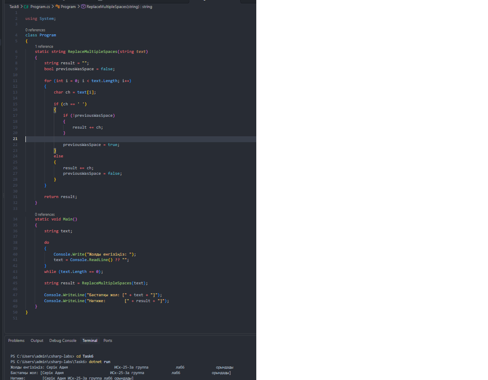

# 6-тапсырма: Символдар тіркесі (string)

**Аты-жөні:** Серік Адия  
**Тобы:** ИСк-25-За  
**Тізімдегі нөмірі:** 12  
**Нұсқа:** 3

## Жұмыстың мақсаты

C# тілінде string типті жолдармен жұмыс істеуді үйрену. Жолды символдар бойынша цикл арқылы өңдеу және қатар тұрған бірнеше бос орынды бір бос орынмен алмастыру.

## Тапсырманың шарты

Пернетақтадан жол енгізіледі. Егер бос жол енгізілсе, бағдарлама қайта сұрайды. Жолдағы қатар тұрған бірнеше бос орын бір бос орынмен алмастырылады. Бастапқы жол мен өңделген нәтиже экранға шығарылады.

## Алгоритмнің сипаттамасы

1. Жол Console.ReadLine() арқылы енгізіледі.
2. Бос жол болса, do-while циклі арқылы қайта енгізіледі.
3. Жолдың әр символы for циклі арқылы тексеріледі.
4. Егер символ бос орын болса және оның алдындағы символ бос орын болмаса, ол нәтижеге қосылады.
5. Егер қатарынан тағы бос орын кездессе, ол нәтижеге қосылмайды.
6. Басқа символдар нәтижеге қосылады.
7. Бастапқы жол мен өңделген нәтиже экранға шығарылады.

## Тестілеу 
| № | Тест түрі | Кіріс деректері | Қолмен есептелген нәтиже | Бағдарлама нәтижесі |
|---|---|---|---|---|
| 1 | Жеке тест | Серік   ИС-21 тобында   2026 жылы C# оқиды.   Lab 6 OK | Серік ИС-21 тобында 2026 жылы C# оқиды. Lab 6 OK | Серік ИС-21 тобында 2026 жылы C# оқиды. Lab 6 OK |
| 2 | Өз тестім 1 | Сәлем    әлем | Сәлем әлем | Сәлем әлем |
| 3 | Өз тестім 2 | A   B     C | A B C | A B C |

## Сұрақтарға жауап

**1. text[i] нені қайтарады, типі қандай? Неге text[i] = 'a'; деп жазуға болмайды?**

text[i] жолдың i индексіндегі бір символын қайтарады. Оның типі — char. C# тілінде string өзгермейтін тип болғандықтан, оның жеке символын индекс арқылы өзгертуге болмайды.

**2. Алдыңғы символ бос орын болғанын программа қалай есте сақтайды?**

Ол үшін previousWasSpace атты bool айнымалысын қолдандым. Егер бос орын кездессе, айнымалы true болады, ал келесі символ бос орын болса, ол нәтижеге қосылмайды. Басқа символ кездескенде айнымалы false болады.

**3. result += ch; орындалғанда жаңа жол жасала ма, әлде ескісі өзгере ме?**

result += ch; орындалғанда жаңа string объектісі жасалады. Себебі string типі өзгермейді, сондықтан бұрынғы жол өзгеріссіз қалады, ал жаңа мән result айнымалысына беріледі.

## Кездескен қате

**Қате:** Жолды өңдеу кезінде `result += ch` тәсілін қолдану әр символ қосылған сайын жаңа string объектісін жасайды. Бұл ұзын жолдарда бағдарламаның жұмысын баяулатуы мүмкін.

**Қалай түзеттім:** `StringBuilder` класын қолдандым. Ол символдарды тиімді жинақтап, жолды өңдеу жұмысын жақсартады.

**Түзетілген коммит:** `033b549` — Task6: StringBuilder арқылы жолды өңдеуді жақсарту.

## Git

**Командалар:**

- `git switch main` — негізгі тармаққа ауысу.
- `git pull` — GitHub-тағы соңғы өзгерістерді алу.
- `git switch -c task6` — task6 тармағын құру және оған ауысу.
- `git add .` — өзгертілген файлдарды коммитке дайындау.
- `git commit` — өзгерістерді жергілікті репозиторий тарихына сақтау.
- `git push` — коммиттерді GitHub-қа жіберу.

### Git сұрақтарына жауап

**1. task5 тармағында жасаған коммиттеріңіз main-ге қалай түсті? Біріктіруден кейін task5 тармағы не болды?**

task5 тармағындағы өзгерістерді GitHub-та Pull Request ашу арқылы main тармағына біріктірдім. Біріктіруден кейін task5 тармағы жеке тармақ ретінде сақталды, ал оның өзгерістері main ішінде де бар.

**2. commit пен push айырмашылығы неде? Push жасамасаңыз, мұғалім не көреді?**

Commit өзгерістерді компьютердегі жергілікті Git тарихына сақтайды. Push сол коммиттерді GitHub серверіне жібереді. Push жасалмаса, мұғалім GitHub-та соңғы өзгерістерді көре алмайды.

**3. .gitignore файлына не жаздыңыз және bin/, obj/ неге репозиторийге қосылмайды?**

.gitignore файлына bin/ және obj/ қалталарын қостым. Бұл қалталарда бағдарламаны құрастыру кезінде автоматты түрде жасалатын уақытша файлдар сақталады, сондықтан оларды репозиторийге жіберудің қажеті жоқ.

## ЖИ қолдану

ЖИ қолдандым басында калай ашылатынында және 5тапсырмада скрин мен кате кеткен осы жолыда дәл солай болды сакталмады сол жерінде қолдандым
## Бағдарлама скриншоты

## Git тарихы
* 033b549 (HEAD -> task6-fixes) Task6: StringBuilder арқылы жолды өңдеуді жақсарту
* 3381075 (origin/main, origin/HEAD, main) README: Task6 сілтемесін қосу
*   371a7ed Merge pull request #2 from Adiyyaa/task6
|\  
| | * f64f182 (refs/stash) On task6: README өзгерісі
| |/| 
| | * 1469c24 index on task6: 5e2cbfe Task6: тапсырманы орындау және құжаттама қосу
| |/  
| * 5e2cbfe (origin/task6, task6) Task6: тапсырманы орындау және құжаттама қосу
|/  
* ff07ffd Task5: README ішіне скриншот қосу
* a5f60c3 README: Task5 сілтемесін қосу
*   afca8e5 Merge pull request #1 from Adiyyaa/task5
|\  
| * 0769f01 (origin/task5, task5) Task5: README толықтыру
| * 413ef26 Task5: GetLength қолдану
| * 8d9cbe7 Task5: скриншотты қосу
| * 4f89a8c Task5: README және құжаттаманы қосу
| * 4f347af Task5: есептеу нәтижелерін тестілеу
| * f776059 Task5: матрицаны құру және экранға шығару
|/  
* 4a34134 Repository: бастапқы құрылымды дайындау
* 91fcd4a Initial commit
